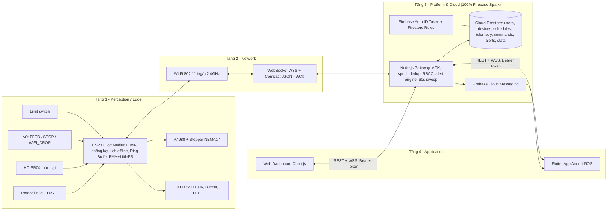
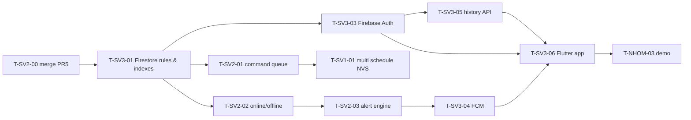

# TODO.md: Đặc tả hệ thống & danh sách việc cần làm (`petty`)

> **Nguồn đối chiếu:** `agent/system.docx` (kiến trúc 4 tầng + bảng linh kiện), `agent/requirements.jpg` (Đề tài 7), `agent/CONFIG.md`.
> **Hiện trạng được phân tích:** nhánh `config` (chuyển đổi hoàn toàn sang 100% Firebase Spark trên nền kiến trúc 4 tầng).
> **Quyết định đã chốt:** (1) làm **Mobile App Flutter** thật; (2) Cloud dùng **100% Firebase (Spark Free Tier — $0/tháng)**: Cloud Firestore, Firebase Authentication, Firestore Security Rules và FCM (`FIREBASE_PROJECT_ID=petty-68437`), không dùng Cloud Functions (Blaze).

**Phân công:**

| Mã | Vai trò | Phạm vi chính |
|---|---|---|
| **SV1** | Hardware & Embedded | `firmware/src/main.cpp`, `sensor_filter.*`, `motor_control.*`, `diagram.json` |
| **SV2** | Networking & Edge | `packet_schema.h`, `ring_buffer.*`, `ws_manager.*`, `backend-ws-gateway/` (luồng thiết bị, lệnh, đồng bộ) |
| **SV3** | Cloud, Security & App | `cloud-database/`, Auth/JWT/RBAC, FCM, `mobile-app/` (Flutter), `dashboard-app/` |
| **NHÓM** | Cả nhóm | Tài liệu Câu 1, demo, nghiệm thu |

---

## 1. Kết luận đối chiếu với `system.docx`

**Kết luận:** hệ thống **CHƯA ĐẠT** đầy đủ đặc tả. Tầng 1 (thiết bị) và phần cơ bản của Tầng 2 (Wi-Fi + WebSocket) đã đạt. Tầng 3 và Tầng 4 còn thiếu các thành phần bắt buộc: FCM, Mobile App Flutter, điều phối lệnh từ Cloud, trạng thái online/offline, TLS.

| # | Yêu cầu `system.docx` | Hiện trạng | Mức đạt | Task xử lý |
|---|---|---|:---:|---|
| 1.1 | ESP32 240MHz, 4MB Flash, Wi-Fi | `esp32dev` | ✅ | - |
| 1.2 | Loadcell 5/10kg + HX711 24-bit | `wokwi-hx711` 5kg, lọc Median+EMA | ✅ | T-SV1-03 (hiệu chuẩn) |
| 1.3 | Stepper NEMA17/28BYJ-48 + ULN2003 | NEMA17 + **A4988** | ⚠️ lệch driver | T-SV1-02 |
| 1.4 | Xử lý biên | Lọc nhiễu, chống kẹt, lịch offline, Ring Buffer | ✅ | T-SV1-01 (lưu lịch bền) |
| 2.1 | Wi-Fi 2.4GHz, TCP/IP | `Wokwi-GUEST` | ✅ | - |
| 2.2 | WebSocket / MQTT / HTTPS | WebSocket | ✅ | - |
| 2.3 | Truyền tải bảo mật | Chỉ `ws://`, token thiết bị nằm trên query string | ❌ | T-SV2-04, T-SV3-07 |
| 3.1 | DB realtime + time-series | Cloud Firestore `telemetry_logs` (composite index + Doc ID `${device_id}_${seq_num}`) + `stats_hourly`/`stats_daily` | ✅ | T-SV3-01, §2.8 |
| 3.2 | Auth JWT + phân quyền Owner/Member | Firebase Auth (ID Token) + HS256 fallback (`auth.js`) + Firestore Security Rules | ✅ | T-SV3-03 |
| 3.3 | **FCM push**: hết thức ăn, mất kết nối | Không có | ❌ | T-SV3-04, T-SV2-03 |
| 3.4 | Trạng thái thiết bị realtime | `devices.online` không bao giờ về `false` | ❌ | T-SV2-02, T-SV3-02 |
| 3.5 | Điều phối lịch ăn từ Cloud | `device_commands` được tạo nhưng Gateway không gửi; lịch chỉ nằm trong RAM của Gateway | ❌ | T-SV2-01, T-SV3-01 |
| 3.6 | Lịch sử cho ăn (time-series logs) | `/api/telemetry` chỉ đọc RAM | ⚠️ | T-SV3-05 |
| 4.1 | **Mobile App Flutter** + `fl_chart` | Không có | ❌ | T-SV3-06 |
| 4.2 | Dashboard, nút cho ăn, lịch, thống kê | Web có, nhưng thống kê mất khi reload, chỉ 1 lịch | ⚠️ | T-SV3-05, T-SV3-08 |
| D.1 | Sơ đồ khối 4 tầng (Câu 1) | Chưa có trong repo (docx cũng thiếu Mục 2) | ❌ | T-NHOM-01 |
| D.2 | Bảng linh kiện / giao thức / Cloud | Chưa có trong repo | ❌ | T-NHOM-01 |

---

## 2. Đặc tả hệ thống đích (Target Specification)

### 2.1 Sơ đồ khối 4 tầng



**Luồng dữ liệu đi lên:** Loadcell → HX711 → ESP32 (lọc) → Compact JSON → WSS → Gateway (spool + ACK) → Cloud Firestore `telemetry_logs` + `stats_hourly`/`stats_daily` → App/Web (realtime qua WS của Gateway, lịch sử qua Gateway API `/api/telemetry` & `/api/stats`).
**Luồng lệnh đi xuống:** App → Gateway REST (JWT, RBAC) → Firestore `device_commands` → WSS → ESP32 → A4988 → Stepper.
**Luồng cảnh báo:** telemetry/sự kiện → Alert engine (Gateway) → collection `alerts` → FCM → điện thoại.

### 2.2 Bảng linh kiện, thông số, giao thức & dịch vụ Cloud

| STT | Thành phần | Linh kiện / Dịch vụ | Thông số chính | Giao thức | Ghi chú triển khai |
|---|---|---|---|---|---|
| 1 | Vi điều khiển & xử lý biên | ESP32 DevKit (NodeMCU-32S) | Dual-core Xtensa 240MHz, 4MB Flash, 520KB SRAM, Wi-Fi b/g/n, BT 4.2 | GPIO, I2C, UART | `board = esp32dev` |
| 2 | Cảm biến khối lượng | Loadcell 5kg + HX711 | ADC 24-bit, 10/80 SPS, 2.7–5V | HX711 2 dây (DOUT/SCK) | DOUT=16, SCK=4 |
| 3 | Thiết bị chấp hành | Stepper NEMA17 + driver **A4988** | 200 bước/vòng, 1.8°/bước, 8–35V, ≤2A/pha | GPIO STEP/DIR/EN | Lệch so với docx (ULN2003), xem T-SV1-02 |
| 3b | Phản hồi hành trình | Limit switch | NO, kéo lên nội | GPIO INPUT_PULLUP | GPIO 32 |
| 3c | Mức hạt trong thùng | HC-SR04 | 2–400cm, ±3mm | GPIO TRIG/ECHO | TRIG=5, ECHO=17 |
| 4 | Mạng | Router Wi-Fi gia đình | 2.4GHz, WPA2 | IEEE 802.11 b/g/n, TCP/IP | Demo: `Wokwi-GUEST` |
| 5 | Giao thức ứng dụng | WebSocket (RFC 6455) | Full-duplex, heartbeat 10s, ACK theo `seq` | WS (demo) / **WSS 443** (deploy) | MQTT không dùng (docx cho phép "hoặc") |
| 6 | Cloud DB | **Cloud Firestore (Firebase Spark)** | Composite index `(device_id ASC, recorded_at DESC)`, chống trùng `${device_id}_${seq_num}`, `stats_hourly`/`stats_daily` | Firebase Admin SDK (HTTPS/gRPC) | Gói Spark $0/tháng, xem §2.8 |
| 7 | Xác thực & thông báo | **Firebase Auth** + **FCM** | Firebase ID Token (`verifyIdToken`), Firestore Security Rules; FCM HTTP v1 | HTTPS / FCM / APNs | Miễn phí hoàn toàn gói Spark (`petty-68437`) |
| 8 | Ứng dụng di động | **Flutter (Dart)** | Android/iOS/Web, `fl_chart`, `web_socket_channel`, `provider`, Firebase Auth REST | REST, WSS, Firebase Auth REST/SDK | Thư mục `mobile-app/` |

### 2.3 Sơ đồ chân (khớp `firmware/include/config.h` & `diagram.json`)

| Chức năng | GPIO | Chức năng | GPIO |
|---|---|---|---|
| HX711 DOUT / SCK | 16 / 4 | OLED SDA / SCL | 21 / 22 |
| A4988 STEP / DIR / EN | 19 / 23 / 18 | Nút FEED / STOP / WIFI_DROP | 25 / 26 / 33 |
| LIMIT_SW | 32 | Buzzer | 27 |
| HC-SR04 TRIG / ECHO | 5 / 17 | LED xanh / đỏ | 14 / 13 |

### 2.4 Giao thức truyền thông

**Telemetry (thiết bị → Gateway)**, giữ nguyên định dạng hiện có:
```json
{"v":1,"id":"esp01","s":104,"t":1763040000,"w":85.4,"l":72,"st":1,"e":0,"src":2,"os":1,"q":3}
```
`st`: 0 Idle, 1 Feeding, 2 Offline-Synced, 3 Error. `e`: 0 OK, 1 Jam, 2 Empty, 3 Sensor. `q`: số gói còn chờ (tùy chọn).
`src`: nguồn cho ăn (0 không rõ, 1 manual, 2 schedule, 3 button). `os`: trạng thái gốc trước khi đánh dấu gói đã đồng bộ offline (`st=2`), để Gateway vẫn suy ra sự kiện cho ăn.

**ACK (Gateway → thiết bị):** `{"ack":104}`, chỉ gửi **sau khi** bản ghi đã được ghi bền (spool, theo PR #5).

**Lệnh (Gateway → thiết bị):**

| Lệnh | Payload | Ghi chú |
|---|---|---|
| `FEED` | `{"cmd":"FEED","g":30,"cid":123}` | `cid` = `device_commands.id` (mới) |
| `STOP` | `{"cmd":"STOP","cid":124}` | |
| `SET_SCHEDULES` (**mới**) | `{"cmd":"SET_SCHEDULES","cid":125,"items":[{"h":7,"m":30,"g":30,"on":true}, ...]}` | Tối đa 4 lịch, thay thế toàn bộ danh sách |
| `SET_SCHEDULE` | giữ để tương thích ngược | Tương đương `items` có 1 phần tử |
| `CLEAR_ERROR` | `{"cmd":"CLEAR_ERROR","cid":126}` | |

**Xác nhận lệnh (thiết bị → Gateway, mới):** `{"cack":125,"ok":true}`. Gateway chỉ set `delivered_at` sau khi nhận `cack`; quá 10s chưa có thì gửi lại (tối đa 3 lần). Thiết bị bỏ qua `cid` đã xử lý (giữ 8 `cid` gần nhất) để lệnh `FEED` không bị chạy 2 lần.

**Sự kiện realtime (Gateway → App/Web):** `snapshot`, `telemetry`, `status` (đã có) + `alert` (**mới**): `{"type":"alert","data":{"id":..,"device_id":"esp01","kind":"LOW_FOOD","message":"...","created_at":"..."}}`.

### 2.5 Mô hình dữ liệu (Cloud Firestore - Spark)

Hệ thống sử dụng 11 Collections trong Cloud Firestore (chi tiết xem `cloud-database/firestore_schema.md`, index tại `cloud-database/firestore.indexes.json`, rules tại `cloud-database/firestore.rules`):

- **`users/{uid}`**: hồ sơ người dùng (`email`, `role`: `'admin' | 'owner' | 'viewer'`, `created_at`).
- **`devices/{device_id}`**: thông tin thiết bị (`id`, `owner_id`, `member_ids` `string[]`, `name`, `online`, `last_seen`, `portion_grams`, `bowl_weight_g`, `food_level`).
- **`feeding_schedules/{scheduleId}`**: lịch cho ăn tự động (`device_id`, `hour`, `minute`, `grams`, `enabled`, `updated_at`).
- **`telemetry_logs/{deviceId}_{seqNum}`**: dữ liệu time-series (`device_id`, `seq_num`, `recorded_at`, `weight_g`, `food_level`, `status`, `error_code`, `synced`, `raw`). Dùng **deterministic Document ID** `${device_id}_${seq_num}` để chống ghi trùng tuyệt đối khi ESP32 xả Ring Buffer.
- **`device_commands/{cid}`**: hàng đợi lệnh từ App/Web (`cid`, `device_id`, `command`, `payload`, `acked`, `attempts`, `created_at`, `delivered_at`).
- **`alerts/{alertId}`**: lịch sử cảnh báo (`device_id`, `kind`, `message`, `created_at`, `pushed`, `read_at`).
- **`feeding_events/{eventId}`**: sự kiện cho ăn suy từ chuyển trạng thái `st` `1 -> 0/3` (`device_id`, `started_at`, `finished_at`, `source`, `target_g`, `dispensed_g`, `result`).
- **`stats_hourly/{deviceId}_{YYYYMMDDHH}`** & **`stats_daily/{deviceId}_{YYYYMMDD}`**: bộ đếm tổng hợp (`device_id`, `bucket`, `eaten_g`) cập nhật nguyên tử bằng `FieldValue.increment` từ Gateway để đọc biểu đồ 24h/7d/30d chỉ tốn ít lượt đọc trên gói Spark.
- **`fcm_tokens/{token}`**: registration token của từng user (`token`, `user_id`, `platform`, `updated_at`).
- **`device_credentials/{deviceId}`**: khóa xác thực thiết bị (`device_id`, `token_hash` SHA-256, `updated_at`), chỉ Admin SDK / admin đọc ghi.

**Quyết định về lịch ăn (tránh cho ăn 2 lần):** **ESP32 là nơi quyết định lịch** để lịch vẫn chạy khi mất mạng. Collection `feeding_schedules` là bản lưu gốc trên Cloud Firestore và được đồng bộ xuống thiết bị bằng `SET_SCHEDULES` mỗi khi lịch thay đổi hoặc khi thiết bị kết nối lại. Cơ chế đánh dấu thiết bị offline (`OFFLINE_STALE_MS = 60s`) chạy định kỳ trong Node.js Gateway (thay thế hoàn toàn `pg_cron` hay Firebase Cloud Functions vốn yêu cầu gói Blaze).

### 2.6 Bảo mật end-to-end

| Lớp | Đặc tả |
|---|---|
| Kênh truyền | Khi deploy (Render/Koyeb): bắt buộc HTTPS/WSS (TLS 1.2+). ESP32 dùng `beginSSL` + root CA. Wokwi demo được dùng `ws://` và phải ghi rõ trong README. |
| Xác thực người dùng | Firebase Auth (email/password qua REST `identitytoolkit` / Firebase SDK). App/Web gửi `Authorization: Bearer <id_token>`. Gateway xác minh qua `firebaseAuth.verifyIdToken` (kèm HS256 `JWT_SECRET` fallback khi chạy demo), kiểm tra quyền từ `users/{uid}`. |
| Xác thực thiết bị | Mỗi thiết bị có token riêng (so khớp `DEVICE_TOKEN` hoặc hash SHA-256 trong `device_credentials`), gửi qua header `Authorization` (`WebSocketsClient::setExtraHeaders`). **Không** đặt token trên query string ở production. |
| RBAC | `admin` = toàn quyền; `owner` = chủ thiết bị (docx: Owner): cho ăn, sửa lịch, mời member; `viewer` = member (docx: Member): chỉ xem và nhận cảnh báo. Role lấy từ `users/{uid}.role` + quan hệ `devices.owner_id` / `devices.member_ids`. |
| Ở DB | `cloud-database/firestore.rules`: chỉ owner/member thuộc `devices.member_ids` hoặc `owner_id` mới đọc được dữ liệu thiết bị; các collection ghi từ Gateway/Admin (`feeding_events`, `stats_*`, `device_credentials`) chặn client thường. |
| Bí mật | `FIREBASE_SERVICE_ACCOUNT` (`./secrets/fcm-service-account.json`) và `JWT_SECRET` chỉ đặt ở Gateway (`.env`, không commit). App chỉ dùng Firebase Web API Key (`FIREBASE_WEB_API_KEY`). Chế độ "JWT OFF = admin" chỉ được bật khi `NODE_ENV=development`. |

### 2.7 Thông báo đẩy (FCM)

| Loại | Điều kiện kích hoạt | Chống spam |
|---|---|---|
| `LOW_FOOD` | `l < 15` | Hysteresis: chỉ gửi lại sau khi `l ≥ 25`; tối đa 1 lần/30 phút |
| `EMPTY` | `e = 2` | 1 lần/30 phút |
| `JAM` | `e = 1` | Gửi ngay, 1 lần/sự cố |
| `SENSOR` | `e = 3` | 1 lần/30 phút |
| `OFFLINE` | Socket thiết bị đóng hoặc không có telemetry > 60s | Gửi 1 lần đến khi online lại |
| `ONLINE` | Thiết bị kết nối lại sau `OFFLINE` | Tùy chọn (mặc định bật) |

**Luồng:** Alert engine ở Gateway chèn bản ghi vào `alerts` → lấy `fcm_tokens` của owner và member của thiết bị → gửi qua `firebase-admin` (`messaging().sendEachForMulticast`), payload `notification` + `data{device_id, kind, alert_id}` → xóa token khi FCM trả `registration-token-not-registered` → set `alerts.pushed = true`, đồng thời broadcast WS `alert`.

### 2.8 Kiến trúc 100% Firebase trên gói Spark ($0/tháng)

| `system.docx` | Triển khai thực tế trong `petty` | Lý do phù hợp gói Spark |
|---|---|---|
| Firebase Realtime Database | Gateway WS broadcast + Cloud Firestore | Độ trễ < 100ms trong LAN, miễn phí |
| Cloud Firestore (logs) | **Cloud Firestore** `telemetry_logs` + `stats_hourly`/`stats_daily` | Chống trùng bằng Doc ID `${device_id}_${seq_num}`, cộng dồn sẵn để tiết kiệm quota đọc Spark |
| Firebase Authentication | **Firebase Auth** (ID Token) + `firestore.rules` | Có RBAC ở mức document theo `owner_id` / `member_ids` |
| Cloud Functions (cron — Blaze) | **ESP32 (NVS + NTP)** + **Gateway 60s offline sweep** | Cloud Functions bắt buộc gói Blaze (trả phí); chạy ở biên + Gateway miễn phí 100% |
| **FCM** | **FCM (`firebase-admin`)** | Gói Spark miễn phí |

### 2.9 Gateway API (đích)

| Method | Path | Role | Mô tả |
|---|---|---|---|
| GET | `/api/health` | public | Trạng thái (`ok`, `uptime_s`, `devices`, `dashboards`, `buffered_records`, `firebase`, `fcm_mode`) |
| GET | `/api/devices` | all | Thiết bị người dùng được thấy + online/last_seen |
| GET | `/api/telemetry?device=&from=&to=&limit=` | all | Lịch sử đọc từ Cloud Firestore `telemetry_logs` (dùng RAM khi chưa cấu hình Firebase) |
| GET | `/api/stats?device=&range=24h\|7d\|30d` | all | Đọc `stats_hourly`/`stats_daily` (fallback tính từ RAM trong demo mode) |
| POST | `/api/feed` `{device, grams}` | owner/admin | Tạo `device_commands` rồi gửi ngay nếu thiết bị online |
| POST | `/api/stop` `{device}` | owner/admin | |
| GET/PUT | `/api/schedules?device=` | xem: all / sửa: owner | CRUD `feeding_schedules` + đẩy `SET_SCHEDULES` |
| GET | `/api/alerts?device=` | all | |
| POST | `/api/fcm-token` `{token, platform}` | all | Upsert `fcm_tokens` lên Firestore / RAM |

---

## 3. Danh sách TODO

Ký hiệu ưu tiên: **P0** = bắt buộc để đạt `system.docx`/đề bài; **P1** = cần cho demo chất lượng; **P2** = hoàn thiện.

### 3.1 SV1: Hardware & Embedded

- [x] **T-SV1-01 (P0): Nhiều lịch ăn + lưu bền qua NVS**
  - File: `firmware/src/main.cpp`
  - Chuyển `FeedingSchedule schedule` thành mảng tối đa 4 lịch; lưu/đọc bằng `Preferences` (namespace `petty-sched`); xử lý lệnh `SET_SCHEDULES`.
  - Ghi `source` khi bắt đầu cho ăn (`manual`/`schedule`/`button`) để Gateway suy ra `feeding_events`.
  - **Nghiệm thu:** đặt 2 lịch, reboot ESP32 khi đang offline thì 2 lịch vẫn chạy đúng giờ (đã có NTP); mỗi slot chỉ chạy 1 lần.
- [x] **T-SV1-02 (P1): Giải trình driver stepper**
  - File: `README.md` §7, `docs/architecture.md` §3.1
  - Ghi rõ A4988 + NEMA17 thay cho ULN2003 + 28BYJ-48 (docx cho phép NEMA17; Wokwi không có ULN2003 cho stepper 2 pha; A4988 cho phép vi bước và tắt dòng bằng EN khi kẹt). Nêu cách đổi sang 28BYJ-48 (dùng AccelStepper `FULL4WIRE` với 4 chân IN1–IN4).
  - **Nghiệm thu:** tài liệu có đoạn so sánh và sơ đồ chân thay thế.
- [x] **T-SV1-03 (P2): Quy trình hiệu chuẩn loadcell**
  - Thêm lệnh Serial `tare` / `cal <gram>` / `cal reset` và giữ nút `STOP` 3s để tare + tính `counts_per_gram`, lưu NVS (`petty-cal`).
  - **Nghiệm thu:** đặt vật 100g, sai số ≤ ±1g sau khi hiệu chuẩn (trên phần cứng thật).
- [x] **T-SV1-04 (P1): Đẩy sự kiện lỗi kịp thời**
  - Đảm bảo `ERR_JAM`, `ERR_EMPTY_TANK`, `ERR_SENSOR_FAULT` được `publishEvent` ngay khi xảy ra (không đợi chu kỳ 5s) và ghi vào Flash nếu đang offline (sự kiện quan trọng, theo CONFIG.md).
  - **Nghiệm thu:** giữ limit switch không nhả trong Wokwi thì Gateway nhận `e=1` trong ≤ 1s sau khi hết 3 lần thử.

### 3.2 SV2: Networking & Edge

- [x] **T-SV2-00 (P0): Hoàn tất PR #5 rồi merge**
  - Sửa `firmware/merge_firmware.py` (`KeyError: 'tool-esptool'`: dùng `tool-esptoolpy` + `esptool.py` chạy bằng `sys.executable`).
  - Sửa `flushSpool()`: coi HTTP 409/duplicate là thành công để hàng đợi không bị kẹt ở bản ghi đầu.
  - **Nghiệm thu:** `pio run -d firmware` thành công và tạo `firmware.merged.bin`; restart Gateway rồi gửi lại gói trùng thì spool vẫn được xả hết.
- [x] **T-SV2-01 (P0): Gửi lệnh từ hàng đợi `device_commands`**
  - File: `backend-ws-gateway/server.js`, `firmware/src/ws_manager.cpp`, `firmware/include/packet_schema.h`
  - REST `/api/feed|stop|schedules` → `insert device_commands` → gửi ngay nếu thiết bị online. Khi thiết bị (re)connect: gửi toàn bộ lệnh `delivered_at is null` theo thứ tự `id`, rồi gửi `SET_SCHEDULES` hiện hành.
  - Firmware: parse `cid`, trả `{"cack":cid,"ok":true}`, bỏ qua `cid` trùng.
  - Lệnh `FEED` tạo quá 10 phút mà chưa gửi được thì hết hạn (`delivered_at` để null, đánh dấu `payload.expired=true`) để thiết bị không xả hạt bất ngờ khi online lại.
  - **Nghiệm thu:** bấm WIFI_DROP, đổi lịch trên App, bấm WIFI_DROP lần nữa để có mạng lại thì thiết bị nhận `SET_SCHEDULES` trong ≤ 5s; `delivered_at` được set.
- [x] **T-SV2-02 (P0): Phát hiện online/offline**
  - Khi socket thiết bị `close` hoặc heartbeat timeout: `PATCH devices set online=false`, broadcast `status`, gọi alert engine (`OFFLINE`) sau 60s nếu thiết bị chưa quay lại.
  - Khi `hello`: `online=true`, `last_seen=now()`.
  - **Nghiệm thu:** ngắt mạng thiết bị thì App hiển thị OFFLINE trong ≤ 60s, có 1 push `OFFLINE`; kết nối lại thì có push `ONLINE`.
- [x] **T-SV2-03 (P0): Alert engine trong Gateway**
  - Module mới `backend-ws-gateway/alerts.js`: áp luật §2.7 trên mỗi telemetry; lưu trạng thái hysteresis/rate-limit theo `(device_id, kind)`; gọi `notify()` do SV3 cung cấp (T-SV3-04).
  - Suy ra `feeding_events` từ chuyển trạng thái `st` 1→0 (`dispensed_g` = cân sau − cân trước).
  - **Nghiệm thu:** unit test bằng `node --test` cho các luật LOW_FOOD (hysteresis), JAM, rate-limit.
- [x] **T-SV2-04 (P1): Bảo mật kênh thiết bị**
  - Firmware gửi token bằng `Authorization` và ID bằng `X-Device-ID`; đường dẫn WS không chứa token. Gateway chỉ cho query token fallback ở development; production bắt buộc token và device ID từ header, đối chiếu SHA-256 với `device_credentials/{device_id}.token_hash`.
  - Môi trường PlatformIO `production` bật `PETTY_TLS`, yêu cầu host/token/CA PEM qua environment và dùng `beginSslWithCA` để kiểm tra chứng thư. Có tiện ích `backend-ws-gateway/scripts/hash-device-token.js` để tạo hash cho credential.
  - **Nghiệm thu:** kết nối không có header bị từ chối với mã 4001; bản build TLS kết nối được tới Gateway đã deploy.
- [x] **T-SV2-05 (P2): Cấu hình Wokwi**
  - Môi trường PlatformIO `wokwi` bật `PETTY_USE_WOKWI_PRIVATE_GW`, firmware dùng `host.wokwi.internal:8080` và WS path không mang token; `wokwi.toml` trỏ tới full merged image.
  - Dùng Wokwi Private IoT Gateway để ESP32 truy cập Gateway host; `[[net.forward]]` chỉ chuyển kết nối host → ESP32, không phải phương án thay thế tương đương. Nếu Gateway bind loopback không truy cập được, bind `HOST=0.0.0.0` và giới hạn truy cập bằng firewall.
  - **Nghiệm thu:** build full image và kết nối được khi tài khoản Wokwi có Private Gateway; tài khoản Community chỉ kiểm chứng boot mô phỏng.

### 3.3 SV3: Cloud, Security & App

- [x] **T-SV3-01 (P0): Cấu hình Cloud Firestore & Security Rules**
  - Files mới: `cloud-database/firestore.rules`, `cloud-database/firestore.indexes.json`, `cloud-database/firestore_schema.md` (thay thế hoàn toàn cấu hình SQL cũ).
  - Bảo mật Firestore Rules cho `fcm_tokens` (user chỉ đọc/ghi token của mình), `alerts` và `feeding_events` (đọc theo `owner_id` / `member_ids`), `device_credentials` và `stats_*` (chỉ Admin SDK / admin ghi).
  - **Nghiệm thu:** deploy rules & composite indexes lên project `petty-68437` không lỗi; user `viewer` không đọc được thiết bị ngoài `member_ids`.
- [x] **T-SV3-02 (P0): Quét thiết bị offline định kỳ tại Gateway (thay `pg_cron` / Cloud Functions)**
  - `backend-ws-gateway/server.js`: chu kỳ 60s kiểm tra `last_seen < now - OFFLINE_STALE_MS` (60s) để cập nhật `online = false` trên Firestore/RAM, broadcast `status` và kích hoạt alert `OFFLINE`. Không cần Blaze Cloud Functions.
  - **Nghiệm thu:** ngắt thiết bị quá 60s thì trạng thái `devices.online` chuyển `false` và phát sinh cảnh báo `OFFLINE`.
- [x] **T-SV3-03 (P0): Firebase Auth thay cho token tự ký**
  - Gateway (`backend-ws-gateway/firebase.js` & `auth.js`): hàm `verifyTokenAsync()` ưu tiên `firebaseAuth.verifyIdToken()`, tra `users/{uid}.role` và quyền sở hữu thiết bị (cache 60s), fallback HS256 `JWT_SECRET` / `signToken` demo khi `NODE_ENV=development`.
  - REST kiểm tra quyền **theo thiết bị** (owner của `esp01` mới được `FEED esp01`).
  - **Nghiệm thu:** đăng nhập bằng tài khoản owner thì cho ăn được; tài khoản viewer gọi `/api/feed` nhận 403; token hết hạn nhận 401.
- [x] **T-SV3-04 (P0): Tích hợp FCM**
  - Firebase project Spark (`FIREBASE_PROJECT_ID=petty-68437`) bật Firestore, Auth và Cloud Messaging; tải service account JSON (không commit).
  - Gateway: `backend-ws-gateway/notify.js` dùng `firebase-admin` Messaging (`sendEachForMulticast`) hoặc `[FCM:DEMO]`; env `FIREBASE_SERVICE_ACCOUNT=./secrets/fcm-service-account.json`, `FIREBASE_PROJECT_ID=petty-68437`; thêm `.env.example`, `.gitignore`.
  - **Nghiệm thu:** kéo HC-SR04 xuống mức < 15% thì điện thoại Android nhận thông báo "Sắp hết thức ăn" trong ≤ 10s, kể cả khi app đang ở background.
- [x] **T-SV3-05 (P1): API lịch sử & thống kê**
  - Collection `stats_hourly`, `stats_daily` cộng dồn bằng `FieldValue.increment`; Gateway `/api/telemetry` (đọc Firestore/RAM), `/api/stats`, `/api/alerts`, `/api/schedules`.
  - **Nghiệm thu:** reload App/Web thì biểu đồ 24h/7 ngày vẫn còn dữ liệu.
- [x] **T-SV3-06 (P0): Mobile App Flutter (`mobile-app/`)**
  - **Cấu trúc:**
    ```text
    mobile-app/
    ├── pubspec.yaml
    ├── android/app/google-services.json      # không commit, có hướng dẫn
    ├── lib/
    │   ├── main.dart                         # init app, state provider, routing
    │   ├── config.dart                       # FIREBASE_PROJECT_ID, FIREBASE_WEB_API_KEY, GATEWAY_* (--dart-define)
    │   ├── models/ (telemetry.dart, device.dart, schedule.dart, alert.dart)
    │   ├── services/
    │   │   ├── auth_service.dart             # Firebase Auth REST (identitytoolkit) + Gateway demo fallback
    │   │   ├── gateway_service.dart          # REST + web_socket_channel, tự reconnect
    │   │   ├── history_service.dart          # đọc /api/stats, /api/telemetry
    │   │   └── push_service.dart             # đăng ký token /api/fcm-token (hỗ trợ FCM SDK tùy chọn)
    │   ├── state/ (providers)                # provider
    │   └── screens/
    │       ├── login_screen.dart
    │       ├── dashboard_screen.dart
    │       ├── schedules_screen.dart
    │       ├── statistics_screen.dart
    │       ├── alerts_screen.dart
    │       └── settings_screen.dart
    └── test/ (widget + unit test)
    ```
  - **Packages:** `web_socket_channel`, `http`, `fl_chart`, `intl`, `provider`, `shared_preferences` (và comment sẵn `firebase_core`, `firebase_auth`, `cloud_firestore`, `firebase_messaging`, `flutter_local_notifications` trong `pubspec.yaml`).
  - **Màn hình & yêu cầu:**

    | Màn hình | Nội dung bắt buộc |
    |---|---|
    | Login | Email/password Firebase Auth REST (khi có `FIREBASE_WEB_API_KEY`) hoặc Gateway demo fallback, hiển thị lỗi |
    | Dashboard | Khối lượng bát (g), mức hạt (%) dạng gauge, trạng thái kết nối `ONLINE / OFFLINE BUFFERING / SYNCING`, số gói đang buffer (`q`), mã lỗi; nút **Cho ăn ngay** (chọn 10–200g) và **Dừng khẩn cấp**; ẩn/khóa nút với `viewer` |
    | Schedules | Danh sách tối đa 4 lịch, thêm/sửa/xóa, bật/tắt; trạng thái "đã đồng bộ xuống thiết bị" |
    | Statistics | `fl_chart`: line chart khối lượng 24h, bar chart lượng ăn theo giờ (24 cột) và theo ngày (7/30 ngày), số lần cho ăn và tỷ lệ lỗi |
    | Alerts | Lịch sử cảnh báo, đánh dấu đã đọc; bấm vào thông báo FCM thì mở màn này |
    | Settings | Chọn thiết bị, khẩu phần mặc định, cấu hình URL Gateway |
  - **Nghiệm thu:** `flutter analyze` sạch, `flutter test` pass; chạy trên Android emulator thực hiện được toàn bộ kịch bản §4.
- [ ] **T-SV3-07 (P1): Deploy TLS**
  - Deploy Gateway lên Render/Koyeb (HTTPS/WSS tự động); App/Web dùng `wss://`; CORS chỉ cho phép origin của dashboard.
  - **Nghiệm thu:** `curl https://<host>/api/health` OK; App kết nối WSS thành công.
- [ ] **T-SV3-08 (P2): Nâng cấp Web Dashboard**
  - Đăng nhập Firebase Auth (hoặc JWT Bearer token) thay ô dán token; biểu đồ lấy dữ liệu từ `/api/stats`; nhiều lịch; danh sách cảnh báo.

### 3.4 NHÓM: Tài liệu & nghiệm thu

- [x] **T-NHOM-01 (P0): Tài liệu Câu 1**
  - File `docs/architecture.md`: sơ đồ khối §2.1, bảng linh kiện §2.2, kiến trúc 100% Firebase Spark §4; README trỏ tới file này.
- [x] **T-NHOM-02 (P1): Cập nhật README**
  - Hướng dẫn chạy đủ 4 thành phần (firmware/Wokwi, Gateway, cấu hình Firebase Firestore/Auth/FCM, Flutter app), danh sách biến môi trường, cách lấy `google-services.json` & `fcm-service-account.json`.
- [ ] **T-NHOM-03 (P1): Diễn tập demo** theo kịch bản §4 và quay video dự phòng.

---

## 4. Kịch bản nghiệm thu end-to-end

| # | Bước | Kết quả mong đợi | Liên quan |
|---|---|---|---|
| 1 | Đăng nhập App bằng tài khoản owner | Dashboard hiện `esp01` ONLINE, số liệu cập nhật mỗi 5s | T-SV3-03, T-SV3-06 |
| 2 | Bấm "Cho ăn ngay 30g" | Stepper quay, `st=1` rồi về 0, cân tăng khoảng 30g, có bản ghi `feeding_events` | T-SV2-01, T-SV2-03 |
| 3 | Đăng nhập tài khoản viewer | Xem được số liệu, nút điều khiển bị khóa, API trả 403 | T-SV3-03 |
| 4 | Giữ LIMIT_SW (giả lập kẹt) | Còi kêu, `e=1`, nhận push "Kẹt hạt" | T-SV1-04, T-SV3-04 |
| 5 | Kéo HC-SR04 để mức hạt < 15% | Push "Sắp hết thức ăn" (chỉ 1 lần) | T-SV2-03, T-SV3-04 |
| 6 | Bấm WIFI_DROP, đợi 60s | App hiện OFFLINE, nhận push "Mất kết nối"; ESP32 ghi buffer xuống LittleFS | T-SV2-02 |
| 7 | Trong lúc offline: sửa lịch trên App | Lệnh nằm trong `device_commands` (pending) | T-SV2-01 |
| 8 | Bấm WIFI_DROP để có mạng lại | Trạng thái SYNCING, số `q` giảm về 0, không trùng bản ghi trong DB, lịch mới được đồng bộ xuống thiết bị | PR #5, T-SV2-01 |
| 9 | Reboot ESP32 | Lịch vẫn còn (NVS) | T-SV1-01 |
| 10 | Mở Statistics, kéo để làm mới (reload) | Biểu đồ giờ/ngày vẫn đầy đủ dữ liệu từ DB | T-SV3-05 |

---

## 5. Thứ tự thực hiện đề xuất


