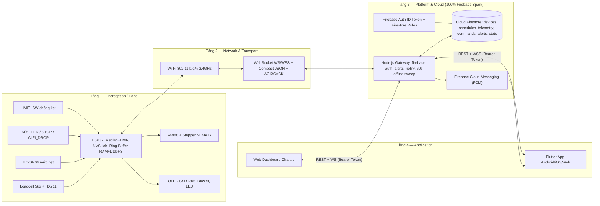

# Kiến trúc 4 tầng IoT — Hệ thống Cho Thú Cưng Ăn Tự Động (`petty`)

> Tài liệu đối chiếu **Câu 1 (4.0 điểm)** theo `agent/requirements.jpg`, `agent/system.docx` và `agent/TODO.md`.

---

## 1. Phân tích kiến trúc 4 tầng IoT

1. **Tầng 1 — Cảm biến & Thiết bị chấp hành (Perception / Edge Layer):**
   - Thu thập khối lượng khay ăn qua **Loadcell 5 kg + HX711 (ADC 24-bit)** và mức thức ăn trong phễu qua **HC-SR04**.
   - Xử lý biên (Edge Computing) trên **ESP32**: lọc nhiễu rung cơ học (Median cửa sổ $N=5$ nối tiếp EMA $\alpha=0.25$), chống kẹt hạt bằng công tắc hành trình `LIMIT_SW` (đảo chiều 60° tối đa 3 lần trước khi ngắt `ENABLE`), chạy lịch hẹn độc lập từ NVS (`Preferences`), lưu đệm 2 tầng (RAM + LittleFS) khi mất mạng.
   - Thiết bị chấp hành: **Động cơ bước NEMA 17 + driver A4988**, màn hình OLED SSD1306, còi Buzzer và LED cảnh báo tại chỗ.

2. **Tầng 2 — Truyền dẫn & Mạng (Network & Transport Layer):**
   - Kết nối cục bộ qua **Wi-Fi IEEE 802.11 b/g/n (2.4 GHz)**.
   - Truyền tải hai chiều thời gian thực qua **WebSocket (WS cục bộ / WSS TLS 1.2+ khi deploy)** với gói tin **Compact JSON** (tương ứng cấu trúc packed 16-byte trên thiết bị), cơ chế xác nhận `{"ack": seq}` cho telemetry và `{"cack": cid, "ok": true}` cho lệnh điều khiển.

3. **Tầng 3 — Nền tảng & Dữ liệu Cloud (Platform & Cloud Layer):**
   - **WebSocket Gateway (Node.js + Express):** đầu cuối tiếp nhận kết nối ESP32/App/Web, xác thực Firebase ID Token / JWT + RBAC (`auth.js`), phát hiện cảnh báo & sự kiện cho ăn (`alerts.js`), quét thiết bị offline định kỳ 60 giây, kích hoạt thông báo đẩy (`notify.js`) và đồng bộ dữ liệu lên Cloud qua `firebase.js`.
   - **Cloud Firestore (Firebase Spark Free Tier):** lưu trữ chuỗi thời gian (`telemetry_logs` chống trùng bằng Document ID `${device_id}_${seq_num}`), người dùng (`users`), thiết bị (`devices`), lịch ăn (`feeding_schedules`), hàng đợi lệnh (`device_commands`), cảnh báo (`alerts`), sự kiện cho ăn (`feeding_events`), token thông báo (`fcm_tokens`), thông tin xác thực thiết bị (`device_credentials`) và bảng tổng hợp tiết kiệm quota đọc (`stats_hourly`, `stats_daily`).
   - **Firebase Authentication & FCM (Spark):** xác thực người dùng bằng JWT ID Token, phân quyền qua **Firestore Security Rules** (`cloud-database/firestore.rules`), và đẩy thông báo khẩn cấp (hết thức ăn, kẹt hạt, mất kết nối) qua **Firebase Cloud Messaging (FCM)** HTTP v1.

4. **Tầng 4 — Ứng dụng & Giao diện người dùng (Application / Presentation Layer):**
   - **Mobile App Flutter (`mobile-app/`):** ứng dụng đa nền tảng Android/iOS/Web dùng `fl_chart`, `web_socket_channel`, `provider`, hỗ trợ đăng nhập, giám sát realtime, điều khiển cho ăn/dừng khẩn cấp, quản lý tối đa 4 lịch hẹn, xem biểu đồ thống kê và nhận cảnh báo FCM.
   - **Web Dashboard (`dashboard-app/`):** giao diện web nhẹ chạy trực tiếp từ Gateway sử dụng Chart.js phục vụ demo nhanh trên trình duyệt.

---

## 2. Sơ đồ khối luồng dữ liệu 4 tầng



* **Luồng dữ liệu đi lên:** Cảm biến (HX711, HC-SR04, LIMIT_SW) $\rightarrow$ ESP32 lọc số & đóng gói $\rightarrow$ WebSocket Gateway (lưu đệm & trả `ACK`) $\rightarrow$ Cloud Firestore `telemetry_logs` + cộng dồn `stats_hourly`/`stats_daily` + Alert Engine $\rightarrow$ Mobile App/Web (realtime WS) & FCM (cảnh báo).
* **Luồng lệnh đi xuống:** Mobile App/Web $\rightarrow$ Gateway REST (`POST /api/feed`, `/api/stop`, `PUT /api/schedules`, kiểm tra JWT/RBAC) $\rightarrow$ Firestore `device_commands` $\rightarrow$ WebSocket Gateway $\rightarrow$ ESP32 (thực thi & trả `CACK`) $\rightarrow$ A4988 + Stepper.

Telemetry thêm `src` để giữ nguồn cho ăn (`0` không rõ, `1` manual, `2` schedule, `3` button). Khi gói offline được đồng bộ với `st=2`, trường `os` giữ trạng thái gốc để Gateway vẫn nhận diện được chuyển trạng thái cho ăn.

---

## 3. Bảng liệt kê linh kiện, thông số, giao thức & dịch vụ Cloud

| STT | Thành phần kiến trúc | Tên linh kiện / Dịch vụ | Thông số kỹ thuật chính | Giao thức kết nối / Truyền thông | Ghi chú triển khai |
|---:|---|---|---|---|---|
| 1 | Vi điều khiển & xử lý biên | ESP32 DevKit (NodeMCU-32S) | Chip Tensilica Dual-Core 32-bit 240 MHz; Flash 4 MB; SRAM 520 KB; Wi-Fi 802.11 b/g/n & BLE 4.2 | GPIO, I2C, UART | PlatformIO `board = esp32dev` |
| 2 | Cảm biến khối lượng | Loadcell 5 kg + ADC HX711 | Tải trọng 5 kg (hoặc 10 kg); ADC 24-bit; tốc độ 10/80 SPS; điện áp 2.7–5 V | Giao tiếp 2 dây HX711 (`DOUT` GPIO 16, `SCK` GPIO 4) | Wokwi `wokwi-hx711` |
| 3 | Thiết bị chấp hành | Động cơ bước NEMA 17 + driver **A4988** | 200 bước/vòng ($1.8^\circ$/bước); dòng điều chỉnh; điện áp 8–35 V (logic 3.3–5 V) | GPIO `STEP` (19), `DIR` (23), `ENABLE` (18) | Dùng A4988 thay ULN2003 (xem mục 3.1) |
| 3b | Phản hồi hành trình & mức hạt | Limit Switch + HC-SR04 | Công tắc hành trình NO (`INPUT_PULLUP`); siêu âm 2–400 cm, sai số $\pm 3$ mm | GPIO 32 (`LIMIT_SW`), `TRIG` 5 / `ECHO` 17 | Mở rộng phục vụ chống kẹt & cảnh báo cạn hạt |
| 4 | Tầng mạng cục bộ | Router Wi-Fi gia đình | Băng tần 2.4 GHz (tương thích ESP32), mã hóa WPA2 | IEEE 802.11 b/g/n, TCP/IP | Wokwi dùng mạng ảo `Wokwi-GUEST` |
| 5 | Giao thức tầng ứng dụng | WebSocket (RFC 6455) | Full-duplex, độ trễ thấp, heartbeat 10 s, backoff $1 \rightarrow 30\text{ s}$ | `ws://` (demo LAN) / `wss://` cổng 443 (TLS 1.2+ deploy) | Đề bài cho phép WebSocket hoặc MQTT |
| 6 | Cloud & Database | **Cloud Firestore (Firebase Spark)** | Composite index `(device_id ASC, recorded_at DESC)`, chống trùng `${device_id}_${seq_num}`, `stats_hourly`/`stats_daily` | Firebase Admin SDK (HTTPS/gRPC) | Miễn phí Spark (50k đọc / 20k ghi mỗi ngày), xem mục 4 |
| 7 | Xác thực & Thông báo | **Firebase Auth + FCM** | Firebase ID Token JWT (`verifyIdToken`), `firestore.rules`; FCM HTTP v1 | HTTPS / FCM / APNs | Không cần thẻ tín dụng trên gói Spark (`petty-68437`) |
| 8 | Ứng dụng di động | **Mobile App Flutter (Dart)** | Đa nền tảng Android / iOS / Web; `fl_chart`, `provider`, `web_socket_channel` | REST API, WSS, Firebase Auth REST/SDK | Thư mục `mobile-app/` |

### 3.1 Giải trình kỹ thuật: Lựa chọn driver A4988 thay cho ULN2003
* Trong bảng tham chiếu có nhắc `28BYJ-48 + ULN2003` hoặc `NEMA 17`. Hệ thống chọn **NEMA 17 + A4988** vì:
  1. NEMA 17 có mô-men xoắn lớn và ổn định hơn để đẩy hạt thức ăn đặc, ít trượt bước khi tải nặng.
  2. A4988 hỗ trợ điều khiển qua 2 chân `STEP/DIR` kèm chân `ENABLE` giúp ngắt dòng tức thời khi phát hiện kẹt hạt (`ERR_JAM`), tránh quá nhiệt cuộn dây.
  3. Wokwi hỗ trợ sẵn mô phỏng chuẩn cặp `wokwi-a4988` + `wokwi-stepper-motor`.
* Nếu chuyển sang phần cứng giá rẻ dùng **28BYJ-48 + ULN2003**, đổi khởi tạo `AccelStepper` trong `firmware/include/motor_control.h` sang chế độ `AccelStepper::FULL4WIRE`:
  ```cpp
  // Thứ tự 1-3-2-4 chuẩn cho động cơ bước 4 pha 28BYJ-48
  AccelStepper _stepper{AccelStepper::FULL4WIRE, 19, 18, 23, 15};
  ```
  Bảng ánh xạ sơ đồ chân thay thế trên ESP32:

  | Chân driver ULN2003 | GPIO ESP32 | Ghi chú thay thế cho A4988 |
  |---|---:|---|
  | `IN1` | `19` | Thay cho `PIN_STEP` |
  | `IN2` | `23` | Thay cho `PIN_DIR` |
  | `IN3` | `18` | Thay cho `PIN_ENABLE` |
  | `IN4` | `15` | GPIO trống trên sơ đồ hiện tại |

  Hiệu chỉnh lại `STEPPER_STEPS_PER_REV = 2048` và `RETRACT_STEPS = 340` ($\approx 60^\circ$ cho hộp số 1:64).

---

## 4. Triển khai 100% Firebase trên gói Spark (Miễn phí - Không cần Cloud Functions)

| Thành phần trong `system.docx` | Triển khai thực tế trong `petty` | Lý do phù hợp gói Spark ($0/tháng) |
|---|---|---|
| Firebase Realtime Database | Gateway WebSocket broadcast + Cloud Firestore | Độ trễ cập nhật tức thời $< 100\text{ ms}$, chạy offline trong LAN khi demo |
| Cloud Firestore (Logs) | **Cloud Firestore** `telemetry_logs` + `stats_hourly`/`stats_daily` | Chống ghi trùng bằng Doc ID `${device_id}_${seq_num}`; thống kê cộng dồn sẵn giúp giảm lượt đọc Spark |
| Firebase Authentication | **Firebase Authentication** (ID Token) + `firestore.rules` | Hỗ trợ sẵn RBAC đến từng thiết bị (`owner_id`, `member_ids`) và vai trò `admin`/`owner`/`viewer` |
| Cloud Functions (Cron — Blaze) | **ESP32 (NVS + NTP)** + **Gateway 60s offline sweep** | Lịch ăn chạy tại biên (ESP32), còn quét offline chạy ở Gateway Node.js nên không cần nâng cấp gói Blaze |
| Firebase Cloud Messaging (FCM) | **FCM (`firebase-admin`)** | Miễn phí hoàn toàn ở gói Spark, gửi Push Notification chuẩn Android/iOS |

---

## 5. Bảo mật API End-to-End & Giao thức

* **Mã hóa kênh truyền:** Môi trường deploy Cloud (Render / Koyeb) sử dụng bắt buộc **HTTPS / WSS (TLS 1.2+)**; PlatformIO `production` yêu cầu hostname, token thiết bị và CA PEM qua environment, sau đó ESP32 dùng `WebSocketsClient::beginSslWithCA` để xác minh chứng thư. Kết nối từ Gateway tới Firebase sử dụng HTTPS/gRPC mặc định của `firebase-admin`.
* **Xác thực người dùng:** Firebase Authentication cấp ID Token JWT (email/password qua Firebase Auth REST/SDK); App/Web đính kèm header `Authorization: Bearer <token>` cho mọi request REST và kết nối WS. Gateway xác minh qua `firebaseAuth.verifyIdToken` (hoặc HS256 `JWT_SECRET` fallback) và đọc vai trò từ `users/{uid}` trong `backend-ws-gateway/auth.js`.
* **Xác thực thiết bị:** ESP32 gửi token qua header `Authorization: Bearer <token>` và ID qua `X-Device-ID`; URL WebSocket không chứa token. Development cho phép token mặc định và query param dự phòng; production bắt buộc cả hai header và chỉ chấp nhận SHA-256 của token khớp `device_credentials/{device_id}.token_hash` trong Firestore. Wokwi dùng Private IoT Gateway và `host.wokwi.internal:8080` để truy cập Gateway local.
* **Phân quyền RBAC (`admin` / `owner` / `viewer`):**
  - `admin`: toàn quyền quản trị hệ thống.
  - `owner` (Chủ nuôi): điều khiển cho ăn (`POST /api/feed`), dừng (`POST /api/stop`), chỉnh sửa lịch (`PUT /api/schedules`), xem thống kê & cảnh báo của thiết bị mình sở hữu (`devices.owner_id == uid`).
  - `viewer` (Member): chỉ xem trạng thái, biểu đồ, cảnh báo của thiết bị được chia sẻ (`uid in devices.member_ids`), mọi lệnh điều khiển bị từ chối với mã HTTP `403`.
